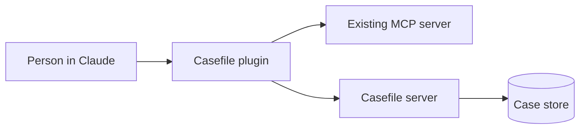

# Casefile

Every support ticket ends with a case file: what happened, the evidence and where it came from,
and a reply that a person approved.

**Status: planning only. No code exists yet.** "Casefile" is a working name that has not been
checked against trademarks or existing products.

## The idea

A ticket's investigation usually lives in people's heads, chat threads and browser tabs. The same
question gets investigated twice, and a reply goes out without anyone being able to show why it is
right.

Casefile gives each ticket one case. The case is built inside Claude from evidence that names its
source, and it ends in a draft that a person approves. When several tickets share one cause, the
case becomes the record of that incident.

## The objective

Turn a support ticket into an evidence-backed investigation that a person approves, for teams that
already work in Claude.

- Every claim in a case names where it came from.
- A person approves anything that is sent.
- It works alongside the MCP server a business already has.

## The project

Casefile does not replace the business's MCP server. It adds two things next to it.

- **The existing MCP server** gives Claude access to the business's tickets and product data.
  Improving it is in scope once someone has access to it.
- **The Casefile server** is a second, small MCP server. It keeps one case per ticket, with its
  evidence. Until the existing server is available, it also serves the synthetic tickets.
- **The Casefile plugin** for Claude Code holds the skills, agents, commands and hooks that run
  the flow.

Three rules hold everywhere:

1. **Synthetic data only.** No real tickets, customers or company names anywhere in this
   repository.
2. **Ticket text is untrusted.** A customer wrote it, so it is handled as data and never as
   instructions.
3. **Nothing is sent without a person.** Casefile drafts; a human approves.

## Tech stack

| Part | Choice |
|---|---|
| Language and runtime | TypeScript in strict mode, Node 22.13 or later |
| MCP | MCP TypeScript SDK version 2, over local stdio first |
| Validation | Zod 4 |
| Storage | SQLite, built into Node |
| Tests | Node's test runner with an in-process MCP client |
| Harness | Claude Code plugin: skills, agents, commands, hooks (formats not verified yet) |
| Later, on a trigger | Streamable HTTP with auth, and Postgres |

## Architecture

A person asks Claude to investigate. The plugin runs the flow, reads tickets and product data from
the existing server, and writes the case and its evidence to the Casefile server.

## System design

- **Reasoning lives in Claude.** The servers store and retrieve; they never call a model.
- **Contract first.** Tool names, inputs and error messages are agreed in the design before code.
- **Adapters at both edges.** One hides where tickets come from; one hides the database.
- **Evidence before conclusion.** A root cause with no supporting evidence is rejected.
- **Approval is code.** A hook gates anything that would be sent outward.

It scales by trigger, not by forecast:

- A second person needs the same cases → HTTP with auth, and Postgres.
- The ticket system limits how fast it can be read → a local ticket cache.
- A second team uses it → a workspace on every row, taken from the login token.

## Code style

- Small files with one responsibility each, grouped by feature.
- Tests first. Every task ends in something that runs.
- Input is validated at the edges, and dependencies are passed in.
- An error says how to recover.
- Every response is paged and capped in size.
- Two runtime dependencies. Nothing is added until a trigger calls for it.
- One branch and one reviewed pull request per issue.

## Assumptions

- **An MCP server already exists** for the business's tickets and product data, and it may need
  improvements. Nobody on this project has reviewed it yet.
- Until someone has access to it, 24 synthetic tickets stand in for it, served by the Casefile
  server.
- The customer is a SaaS business with a support queue, and its team already works in Claude.
- The team is three engineers and one product owner. A two-day hackathon is the proposed first
  step.
- Nothing has been built or measured, so there are no capacity or cost figures.

Checked against current docs: the server plan matches version 2 of the MCP TypeScript SDK and
Zod 4.

Not checked yet:

- One plugin runs in Claude Code in the terminal, on desktop and on the web.
- Claude Desktop and claude.ai can connect to the Casefile server as a connector.
- Claude in Chrome can reproduce an issue in a product's UI.

## Docs

| Read | For |
|---|---|
| [Design](docs/superpowers/specs/2026-11-19-casefile-design.md) | What it is, architecture, scaling by trigger, entity model, risks and open decisions. |
| [Epics and process](docs/superpowers/plans/2026-11-19-casefile-epics-and-process.md) | Epics, issues, roles and how the team works. |
| [MCP server plan](docs/superpowers/plans/2026-11-19-casefile-mcp-server.md) | The Casefile server, in six test-first tasks. |
| [Branding and story](docs/superpowers/specs/2026-11-19-casefile-branding.md) | Name, voice, visual direction and the demo story. |

## Resources

**Libraries**

| Library | Used for |
|---|---|
| [`@modelcontextprotocol/server`](https://github.com/modelcontextprotocol/typescript-sdk), version 2 | The Casefile server. |
| `@modelcontextprotocol/client` | Tests and the self-check. |
| [Zod 4](https://zod.dev/) | Validating tool input and ticket data. |
| [`node:sqlite`](https://nodejs.org/api/sqlite.html) | The case store. |
| [`node:test`](https://nodejs.org/api/test.html) and [tsx](https://tsx.is/) | Running the tests. |

**Documentation**

- [Model Context Protocol](https://modelcontextprotocol.io/): the protocol itself.
- [MCP TypeScript SDK, version 2 docs](https://ts.sdk.modelcontextprotocol.io/v2/llms.txt). Most
  examples found online are version 1 and do not apply.
- Claude Code: [plugins](https://code.claude.com/docs/en/plugins),
  [skills](https://code.claude.com/docs/en/skills),
  [subagents](https://code.claude.com/docs/en/sub-agents),
  [hooks](https://code.claude.com/docs/en/hooks) and
  [MCP](https://code.claude.com/docs/en/mcp).
- [Claude Agent SDK](https://code.claude.com/docs/en/agent-sdk/overview): for running the flow
  without a person, which the evals need.
- [Claude in Chrome](https://claude.com/claude-in-chrome): for reproducing an issue in a browser.

**Tools and examples**

- [MCP Inspector](https://github.com/modelcontextprotocol/inspector): try a server by hand.
- [MCP SDK examples](https://github.com/modelcontextprotocol/typescript-sdk/tree/main/examples):
  auth, HTTP serving and more, for the later stages.
- [anthropics/skills](https://github.com/anthropics/skills): example skills, including
  `mcp-builder` and `skill-creator`.
- [anthropics/claude-cookbooks](https://github.com/anthropics/claude-cookbooks): worked examples
  for agents and tool use.
- [obra/superpowers](https://github.com/obra/superpowers): the planning and test-first workflow
  these documents follow.

**APIs**

- The first version calls no external API. Tickets are synthetic.
- Needed later: access to the existing MCP server, and the API of whichever help desk is chosen.

**Already on hand, public**

- [spaceapps-flightdeck](https://github.com/RikepilB/spaceapps-flightdeck): an earlier hackathon
  harness by the same author. It has a plugin with agents and skills, an eval runner with fixtures
  and scenarios, a safety file for untrusted content, and skills for hackathon planning and pitch
  preparation. It is the closest template for the Casefile plugin and evals.
- [claude-plugins-official](https://github.com/anthropics/claude-plugins-official): `plugin-dev`
  (plugin structure, skills, agents, commands, hooks), `mcp-server-dev` and `hookify`. Use these
  to verify the plugin formats listed above as not verified.
- [claude-cookbooks](https://github.com/anthropics/claude-cookbooks): `tool_evaluation`, the site
  reliability and observability agents under `claude_agent_sdk`, and
  `tool_use/customer_service_agent.ipynb`.
- [mattpocock/skills](https://github.com/mattpocock/skills): `triage`, `to-spec`, `to-tickets`,
  `domain-modeling` and `tdd`.
- [SkillVault](https://github.com/RikepilB/SkillVault): a curated pack of third-party skills,
  grouped as design, security, debug, backend and process.
- [everything-claude-code](https://github.com/affaan-m/everything-claude-code): a hooks reference,
  a security guide that covers prompt injection, and an eval-harness skill.
- [get-shit-done](https://github.com/gsd-build/get-shit-done): subagent definitions for planning,
  verification and eval auditing.

Third-party skills and plugins are scanned before anyone installs them.

**Already on hand, private** (on the maintainer's machine; ask for a copy)

- `skills-lab`: the maintainer's own skills, including `grill-with-docs` (sharpen the idea),
  `disposable-prototype` (a throwaway spike), `debug-evidence-loop` and `handoff-context`.
- Notes vault, `06_Media/Transcripts/Claude-Code_Agent_Workflows`: notes on harness design and on
  choosing between an API, an MCP server and a skill.
- Notes vault, `01_Academy/AI_Engineering_Foundations`: guides on Claude Code setup, subagent
  workflows, MCP servers and system design.

## Plan: a two-day hackathon (proposed)

The hackathon version follows the incident lifecycle that on-call tools use, cut down to what can
be shown on synthetic tickets inside Claude. The design doc has not been updated for it yet.

| Step | What Casefile does | Left out |
|---|---|---|
| Detect | Finds tickets that share key terms and proposes an incident. | Monitoring alerts, paging, on-call schedules. |
| Declare | Opens one case for the incident and links the related tickets as evidence. | Chat channels, role assignment, video calls. |
| Investigate | Records hypotheses and evidence with sources, then a root cause. | Nothing. |
| Communicate | Drafts a customer reply and a status update. A person approves; nothing is sent. | Publishing to a status page. |
| Review | Drafts a post-incident review from the case's timeline. | Metrics and follow-up tracking. |

| When | Engineers | Product owner |
|---|---|---|
| Day 1, morning | Agree the tool contract. Build the ticket schema, fixture source and case store. Verify the plugin format. | Write the synthetic tickets, including one group with a shared cause. |
| Day 1, afternoon | Finish the server tools so the server runs in Claude Code. Write the `investigate` skill. | Write the demo script and the expected result for each ticket. |
| Day 2, morning | Write the skills for detect and declare, status update, and review. Run the whole flow once. | Run the flow as a user and report what is confusing. |
| Day 2, afternoon | Stop adding features. Fix only what breaks the demo. | Rehearse the demo and record a backup. |

If the team falls behind, cut in this order: the review skill, case statistics, similarity
quality. Never cut the untrusted-text marking, evidence with sources, or the rule that nothing is
sent.

Whether this fits in two days is a judgment, not a measurement. The cut order is there for that
reason. What comes after the hackathon is in
[Epics and process](docs/superpowers/plans/2026-11-19-casefile-epics-and-process.md).
