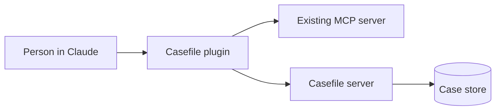

# Casefile

Casefile helps a support team take a customer's problem from the first ticket to a closed case.
It keeps what is known about the client, treats tickets about the same problem as one incident,
and holds the evidence, the drafts and the review in one case. Anyone on the team, technical or
not, can pick a case up where the last person left it. A person approves everything that goes out.

**Status: planning only. No code exists yet.** "Casefile" is a working name that has not been
checked against trademarks or existing products.

## The idea

Three things slow a support team down:

- **One problem arrives as several tickets.** Each is picked up on its own, so it is investigated
  more than once and customers get different answers.
- **The person working a ticket lacks the client's context.** Which systems the client runs, how
  they use the product and what happened before sit in other people's heads, so the answer is
  generic.
- **Work is hard to hand over.** The state of an investigation lives in a chat thread, so the next
  person starts again.

Casefile keeps two records and builds everything on them:

- A **client profile**: the client's systems, background and workflow, collected once through a
  short guided intake and easy to add to.
- A **case** per incident: the related tickets, the evidence with its sources, the drafts and the
  review.

It follows the lifecycle that on-call teams use (detect, declare, investigate, communicate,
review), but it starts from tickets instead of monitoring alerts. It runs inside Claude, next to
the MCP server the business already has.

## The objective

A team can take in a support problem, hand it over, work it and close it, without redoing work
and with an answer that fits the client. It has to work for technical and non-technical teammates
alike.

The first version is done when a demo on synthetic data shows all of this:

- A profile for one client is built from a short intake and pasted notes.
- Six tickets about the same PDF export problem end up in one case, not six.
- A second person picks the case up part-way, using only the case.
- The root cause is backed by evidence, and every evidence item names its source.
- A reply to that client, which reflects their profile, and one status update for everyone
  affected are drafted from the case. Nothing is sent.
- The case is closed, and a post-incident review is drafted from its timeline.
- A ticket that contains hidden instructions (`T-1014`) is reported and not obeyed.
- Every step starts from a plain-language request. Nobody writes code or a query.
- All of it runs next to the existing MCP server, with synthetic tickets standing in for it until
  that server is available.

If time runs out, the cut order in the plan says which of these drop first.

## The project

Casefile runs six steps:

| Step | What Casefile does | Not included |
|---|---|---|
| Know the client | Collects the client's systems, background and workflow into a profile, from a short guided intake or pasted notes. Later steps read the profile of the client on the ticket. | Syncing from a CRM. |
| Detect | When asked, finds tickets that share key terms and proposes treating them as one incident. | Monitoring alerts, paging, on-call schedules. |
| Declare and hand over | Opens one case on the first ticket and links the related tickets to it as evidence. Anyone can pick the case up, because it holds everything known so far. | Chat channels, role assignment, video calls. |
| Investigate | Records hypotheses and evidence, each with its source, then a root cause. | Nothing. |
| Communicate | Drafts a reply to the client on the first ticket, using their profile, and one status update for everyone affected. A person approves; Casefile sends nothing. | Publishing to a status page. |
| Close and review | Marks the case resolved and drafts a post-incident review from its timeline. | Metrics and follow-up tracking. |

Three pieces are not in the server contract yet, and each is an open decision in the design:

- **The client profile.** The proposed first version is one Markdown file per synthetic client
  that the skills read. The ticket schema has no client identifier, so how a ticket is matched to
  a profile is part of the same decision; the demo uses one profile, for the client on the first
  ticket. Material collected from a client is handled like ticket text: as data, never as
  instructions.
- **An owner on a case.** A case can be picked up by anyone today; naming who has it is a proposed
  small addition.
- **The status update and the review.** Only the reply is saved on the case. The other two are
  written in the conversation.

Casefile does not replace the business's MCP server. It adds two things next to it.

- **The existing MCP server** gives Claude access to the business's tickets and product data.
  Improving it is in scope once someone has access to it.
- **The Casefile server** is a second, small MCP server. It keeps one case per ticket, with its
  evidence. Until the existing server is available, it also serves the synthetic tickets.
- **The Casefile plugin** for Claude Code holds the skills, agents, commands and hooks that run
  the flow.

Three rules hold everywhere:

1. **Synthetic data only.** No real tickets, customers or company names anywhere in this
   repository.
2. **Ticket text is untrusted.** A customer wrote it, so it is handled as data and never as
   instructions.
3. **Nothing is sent without a person.** Casefile drafts; a human approves.

## Tech stack

| Part | Choice |
|---|---|
| Language and runtime | TypeScript in strict mode, Node 22.13 or later |
| MCP | MCP TypeScript SDK version 2, over local stdio first |
| Validation | Zod 4 |
| Storage | SQLite, built into Node |
| Tests | Node's test runner with an in-process MCP client |
| Harness | Claude Code plugin: skills, agents, commands, hooks (formats not verified yet) |
| Later, on a trigger | Streamable HTTP with auth, and Postgres |

## Architecture

A person asks Claude to investigate. The plugin runs the flow, reads tickets and product data from
the existing server, and writes the case and its evidence to the Casefile server.

## System design

- **Reasoning lives in Claude.** The servers store and retrieve; they never call a model.
- **Contract first.** Tool names, inputs and error messages are agreed in the design before code.
- **Adapters at both edges.** One hides where tickets come from; one hides the database.
- **Evidence before conclusion.** A root cause with no supporting evidence is rejected.
- **Approval is code.** A hook gates anything that would be sent outward.

It scales by trigger, not by forecast:

- A second person needs the same cases → HTTP with auth, and Postgres.
- The ticket system limits how fast it can be read → a local ticket cache.
- A second team uses it → a workspace on every row, taken from the login token.

It connects to whatever systems a company has:

- **Roles, not products.** Casefile needs a ticket source, client knowledge, product and account
  data, logs, and code. Skills name the role and never a vendor.
- **MCP is the plug.** Each system connects as an MCP server: the company's own, a vendor's, or a
  thin one written for it.
- **One capability map per company.** It says which server and tool fills each role. Changing the
  help desk means editing the map, not the skills.
- **One shape inside.** Tickets, cases, evidence and profiles each have one schema. Adapters
  translate and validate at the edge.
- **A missing role does not stop the flow.** The step says what it could not check and continues.
- **The contract only grows.** Fields and tools are added, never renamed, and every adapter passes
  the same tests as the synthetic source.

## Code style

- Small files with one responsibility each, grouped by feature.
- Tests first. Every task ends in something that runs.
- Input is validated at the edges, and dependencies are passed in.
- An error says how to recover.
- Every response is paged and capped in size.
- Two runtime dependencies. Nothing is added until a trigger calls for it.
- One branch and one reviewed pull request per issue.

## Assumptions

- **An MCP server already exists** for the business's tickets and product data, and it may need
  improvements. Nobody on this project has reviewed it yet.
- Until someone has access to it, 24 synthetic tickets stand in for it, served by the Casefile
  server.
- The customer is a SaaS business with a support queue, and its team already works in Claude.
- The team is three engineers and one product owner. A two-day hackathon is the proposed first
  step.
- Nothing has been built or measured, so there are no capacity or cost figures.

Checked against current docs: the server plan matches version 2 of the MCP TypeScript SDK and
Zod 4.

Not checked yet:

- One plugin runs in Claude Code in the terminal, on desktop and on the web.
- Claude Desktop and claude.ai can connect to the Casefile server as a connector.
- Claude in Chrome can reproduce an issue in a product's UI.

## Docs

| Read | For |
|---|---|
| [Design](docs/superpowers/specs/2026-11-19-casefile-design.md) | What it is, architecture, scaling by trigger, entity model, risks and open decisions. |
| [Epics and process](docs/superpowers/plans/2026-11-19-casefile-epics-and-process.md) | Epics, issues, roles and how the team works. |
| [MCP server plan](docs/superpowers/plans/2026-11-19-casefile-mcp-server.md) | The Casefile server, in six test-first tasks. |
| [Branding and story](docs/superpowers/specs/2026-11-19-casefile-branding.md) | Name, voice, visual direction and the demo story. |
| [Claude API Explorer](https://claude.ai/artifact/F5BfbN3qqbres8zMU1fuGL) | An interactive walkthrough of the pieces Casefile is built from: API keys, the SDK, tools, MCP, agents, billing and scheduled jobs, one message at a time. [Download the HTML](docs/explainer/claude-api-explorer.html) to open it offline; the [source and build notes](docs/explainer/README.md) sit next to it. |

## Resources

**Libraries**

| Library | Used for |
|---|---|
| [`@modelcontextprotocol/server`](https://github.com/modelcontextprotocol/typescript-sdk), version 2 | The Casefile server. |
| `@modelcontextprotocol/client` | Tests and the self-check. |
| [Zod 4](https://zod.dev/) | Validating tool input and ticket data. |
| [`node:sqlite`](https://nodejs.org/api/sqlite.html) | The case store. |
| [`node:test`](https://nodejs.org/api/test.html) and [tsx](https://tsx.is/) | Running the tests. |

**Documentation**

- [Model Context Protocol](https://modelcontextprotocol.io/): the protocol itself.
- [MCP TypeScript SDK, version 2 docs](https://ts.sdk.modelcontextprotocol.io/v2/llms.txt). Most
  examples found online are version 1 and do not apply.
- Claude Code: [plugins](https://code.claude.com/docs/en/plugins),
  [skills](https://code.claude.com/docs/en/skills),
  [subagents](https://code.claude.com/docs/en/sub-agents),
  [hooks](https://code.claude.com/docs/en/hooks) and
  [MCP](https://code.claude.com/docs/en/mcp).
- [Claude Agent SDK](https://code.claude.com/docs/en/agent-sdk/overview): for running the flow
  without a person, which the evals need.
- [Claude in Chrome](https://claude.com/claude-in-chrome): for reproducing an issue in a browser.

**Tools and examples**

- [MCP Inspector](https://github.com/modelcontextprotocol/inspector): try a server by hand.
- [MCP SDK examples](https://github.com/modelcontextprotocol/typescript-sdk/tree/main/examples):
  auth, HTTP serving and more, for the later stages.
- [anthropics/skills](https://github.com/anthropics/skills): example skills, including
  `mcp-builder` and `skill-creator`.
- [anthropics/claude-cookbooks](https://github.com/anthropics/claude-cookbooks): worked examples
  for agents and tool use.
- [obra/superpowers](https://github.com/obra/superpowers): the planning and test-first workflow
  these documents follow.

**APIs**

- The first version calls no external API. Tickets are synthetic.
- Needed later: access to the existing MCP server, and the API of whichever help desk is chosen.

**Already on hand, public**

- [spaceapps-flightdeck](https://github.com/RikepilB/spaceapps-flightdeck): an earlier hackathon
  harness by the same author. It has a plugin with agents and skills, an eval runner with fixtures
  and scenarios, a safety file for untrusted content, and skills for hackathon planning and pitch
  preparation. It is the closest template for the Casefile plugin and evals.
- [claude-plugins-official](https://github.com/anthropics/claude-plugins-official): `plugin-dev`
  (plugin structure, skills, agents, commands, hooks), `mcp-server-dev` and `hookify`. Use these
  to verify the plugin formats listed above as not verified.
- [claude-cookbooks](https://github.com/anthropics/claude-cookbooks): `tool_evaluation`, the site
  reliability and observability agents under `claude_agent_sdk`, and
  `tool_use/customer_service_agent.ipynb`.
- [mattpocock/skills](https://github.com/mattpocock/skills): `triage`, `to-spec`, `to-tickets`,
  `domain-modeling` and `tdd`.
- [SkillVault](https://github.com/RikepilB/SkillVault): a curated pack of third-party skills,
  grouped as design, security, debug, backend and process.
- [everything-claude-code](https://github.com/affaan-m/everything-claude-code): a hooks reference,
  a security guide that covers prompt injection, and an eval-harness skill.
- [get-shit-done](https://github.com/gsd-build/get-shit-done): subagent definitions for planning,
  verification and eval auditing.

Third-party skills and plugins are scanned before anyone installs them.

**Already on hand, private** (on the maintainer's machine; ask for a copy)

- `skills-lab`: the maintainer's own skills, including `grill-with-docs` (sharpen the idea),
  `disposable-prototype` (a throwaway spike), `debug-evidence-loop` and `handoff-context`.
- Notes vault, `06_Media/Transcripts/Claude-Code_Agent_Workflows`: notes on harness design and on
  choosing between an API, an MCP server and a skill.
- Notes vault, `01_Academy/AI_Engineering_Foundations`: guides on Claude Code setup, subagent
  workflows, MCP servers and system design.

## Plan: a two-day hackathon (proposed)

The first version is the six steps above, shown on synthetic data inside Claude.

| When | Engineers | Product owner |
|---|---|---|
| Day 1, morning | Agree the tool contract. Build the ticket schema, fixture source and case store. Verify the plugin format. | Write the synthetic tickets, including one group with a shared cause, and one synthetic client profile. |
| Day 1, afternoon | Finish the server tools so the server runs in Claude Code. Write the `investigate` skill. | Write the demo script and the expected result for each ticket. |
| Day 2, morning | Write the skills for client intake, detect and declare, status update, and review. Run the whole flow once. | Run the flow as a non-technical user and report what is confusing. |
| Day 2, afternoon | Stop adding features. Fix only what breaks the demo. | Rehearse the demo and record a backup. |

If the team falls behind, cut in this order: the review skill, the guided intake (write the
profile by hand instead), case statistics, similarity quality. Never cut the untrusted-text marking, evidence with sources, or the rule that nothing is
sent.

Whether this fits in two days is a judgment, not a measurement. The cut order is there for that
reason. What comes after the hackathon is in
[Epics and process](docs/superpowers/plans/2026-11-19-casefile-epics-and-process.md).
